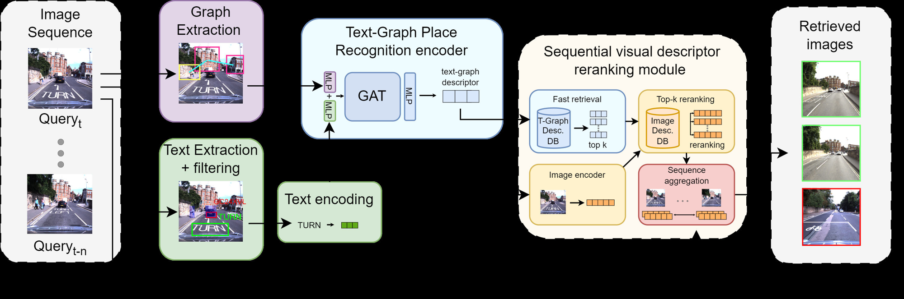
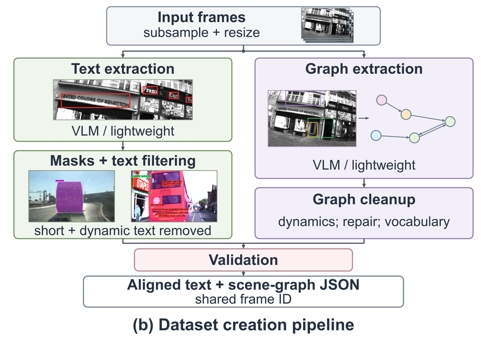

# TGSeqLoc

This is the official repository for the ICRA 2027 submission "TGSeqLoc: Text-aware 3D Scene Graph-based Place Recognition on Image Sequences".

## Summary

TGSeqLoc represents a place by the objects visible in a frame, their spatial relations and the scene text carried by persistent objects. From every frame we extract a scene graph and recognized strings, discard strings supported by ephemeral objects (people, vehicles, bags, screens), and encode the graph with a single-layer GATv2 together with the retained strings, each tied to the class of its supporting object. The result is a 256-dimensional unit-norm descriptor that selects a small candidate set ahead of a foundation-descriptor reranker. On the V4RL shopping street, text raises Recall@1 from 68.38% to 95.45% over the same encoder without text, while a control with strings shuffled across the dataset falls below the text-free encoder.

Because no public place-recognition dataset provides aligned scene graphs and scene text, the repository also contains the annotation pipeline that produces both from raw frames.



## Repository layout

```
annotate_text.py        # text annotation of a folder of frames (filtered or unfiltered)
annotate_graphs.py      # scene-graph annotation of a folder of frames
check_annotations.py    # acceptance checks of an annotated corpus
train.py                # train on annotations, keep the best validation epoch, test it
eval.py                 # Recall@1/5/10 of a trained model on annotations
configs/                # one YAML file per experiment of the paper
src/tgseqloc/           # the package (annotation, data, preparation, models, training, evaluation)
tests/
```

## Getting Started

The code is tested with Python 3.13, PyTorch 2.11 (CUDA 12.8) and PyTorch Geometric 2.7.

```bash
uv sync                      # training and evaluation
uv sync --extra annotation   # + segmentation and detector-based graph generators
```

or, with pip, `pip install -r requirements.txt && pip install -e .`. Text recognizers (Qwen3-VL through vLLM, PaddleOCR) need their own environments, see [requirements_annotation.txt](requirements_annotation.txt).

### Datasets and annotations

Training and evaluation read only annotations and ground truth; images are needed only to produce annotations. Download the annotations (LINK) and arrange the folders as follows:

```
datasets
└── v4rl
    └── gt_shop_street_1.txt             # ground-truth correspondences shipped with V4RL
annotations
└── v4rl
    ├── text
    │   ├── qwen3_vl_4b-yolo11x_seg      # text of the paper; YOLO11x-seg dynamic scores
    │   │   ├── seq1                     # 7,494 database frames
    │   │   │   └── 000000_1465238011340417397.json
    │   │   └── seq2                     # 8,577 query frames
    │   ├── qwen3_vl_4b-yolo11m_seg      # same strings, YOLO11m-seg dynamic scores (Sec. IV-E.1)
    │   └── qwen3_vl_4b-yoloe_11l_seg    # same strings, YOLOE-11L-seg dynamic scores (Sec. IV-E.1)
    └── graphs
        ├── mask2former                  # Tables II and IV, Sec. IV-E
        ├── grounding_dino               # Table II, final configuration
        ├── reltr                        # Table II
        ├── gemini_3_1_flash_lite        # Table II
        ├── scenegraphvlm_pvsg           # Table II
        └── scenegraphvlm_ft             # Table II
            ├── seq1
            └── seq2
```

The V4RL frames and `gt_shop_street_1.txt` come from the V4RL urban place recognition dataset (Vision for Robotics Lab, ETH Zurich). A frame is identified by its image file name without extension, `{index:06d}_{timestamp_ns}`, and the text and graph files of a frame share that identifier.

<!-- TODO: TGSeqLoc-Street (images, poses, annotations) and Oxford RobotCar annotations: links and folder layout. -->

A text annotation holds every recognized string with its normalized box and the fraction of the box covered by dynamic-object masks:

```json
{"frame_id": "000375_1465238030088032624", "image_size": [752, 480],
 "model_identity": {"ocr": "qwen3_vl_4b", "segmenter": "yolo11x_seg"},
 "detections": [{"box": [0.437, 0.298, 0.643, 0.408], "text": "DEPOT", "confidence": 1.0, "dynamic_score": 0.0}]}
```

A scene graph is node-link JSON with boxes normalized by the frame size:

```json
{"directed": true, "multigraph": true,
 "graph": {"scene_name": "000375_1465238030088032624", "generator": "grounding_dino"},
 "nodes": [{"id": 1, "data": {"class_name": "window", "bbox_2d": {"xyxy": [0.175, 0.048, 0.292, 0.214]}}}, ...],
 "links": [{"source": 1, "target": 2, "label": "next to"}, ...]}
```

## Test

Evaluate a trained model on the V4RL test queries (the last 20% of the query sequence, 1,012 queries against 7,494 database frames):

```bash
python eval.py --config configs/v4rl/set_mask2former.yaml --resume weights/v4rl/set_mask2former.pth \
    --datasets_folder datasets --annotations_folder annotations
```

The annotations are prepared into graphs with the node-class and relation vocabularies stored in the checkpoint, every query is searched against the whole database by exact cosine similarity, and a query counts as located when a retrieved database frame falls inside its annotated correspondence interval. Each configuration file states the Recall@1/5/10 it is expected to reproduce.

<!-- TODO: reranking with EDTformer descriptors (K = 1000) and sequence fusion (Sec. III-E); TGSeqLoc-Street evaluation of the RobotCar model (Table VI). -->

## Train

```bash
python train.py --config configs/v4rl/set_mask2former.yaml --datasets_folder datasets --annotations_folder annotations
```

Training uses the triplet loss (margin 0.3) with two negatives per query, random negatives for the first ten epochs and the hardest negatives afterwards, AdamW (learning rate 3e-5, weight decay 1e-4), batches of eight triplets, gradient clipping at 5, and at most 30 epochs with patience five on validation Recall@5. The best validation epoch is evaluated on the test queries. All configurations use seed 42.

## Trained Models

All checkpoints below were trained with the configurations in `configs/v4rl` and evaluated on the same 1,012 V4RL test queries.

| Configuration | Paper | R@1 | R@5 | R@10 | Weights |
|---|---|---|---|---|---|
| `set_mask2former` | Table IV (set fusion), Table V (graph only) | 95.45 | 97.63 | 98.12 | LINK |
| `set_grounding_dino` | set fusion with Grounding DINO graphs (Sec. IV-B.3) | 97.04 | 98.91 | 98.91 | LINK |
| `additive_mask2former` | Table IV (additive anchor), Table II (Mask2Former) | 89.33 | 92.39 | 92.98 | LINK |
| `text_node_mask2former` | Table IV (text-node fusion) | 91.60 | 92.89 | 93.97 | LINK |
| `no_text_mask2former` | Table IV (no text) | 68.38 | 80.24 | 83.79 | LINK |
| `shuffled_mask2former` | Table IV (shuffled strings) | 64.13 | 76.19 | 81.62 | LINK |
| `additive_grounding_dino` | Table II (Grounding DINO) | 91.21 | 95.95 | 96.84 | LINK |
| `additive_reltr` | Table II (RelTR) | 87.75 | 92.89 | 94.37 | LINK |
| `additive_gemini` | Table II (Gemini 3.1 Flash Lite) | 85.08 | 90.02 | 92.29 | LINK |
| `additive_scenegraphvlm_pvsg` | Table II (SceneGraphVLM, PVSG) | 72.73 | 82.91 | 86.26 | LINK |
| `additive_scenegraphvlm_ft` | Table II (SceneGraphVLM, ft) | 80.24 | 88.74 | 91.01 | LINK |

Ablations of Sec. IV-E (`configs/v4rl/ablations`), each changing one factor of the additive anchor or of the set configuration:

| Configuration | Paper | R@1 | R@5 | R@10 | Weights |
|---|---|---|---|---|---|
| `no_dynamic_filter` | IV-E.1, dynamic-text filter off | 86.86 | 92.59 | 94.17 | LINK |
| `segmenter_yolo11m` | IV-E.1, YOLO11m-seg | 87.65 | 92.29 | 93.87 | LINK |
| `segmenter_yoloe_11l` | IV-E.1, YOLOE-11L-seg | 86.76 | 91.90 | 93.18 | LINK |
| `encoder_char_ngram_384` | IV-E.2, character n-grams, 384 buckets | 86.86 | 91.40 | 92.79 | LINK |
| `encoder_multilingual_e5_small` | IV-E.2, multilingual-e5-small | 86.07 | 92.49 | 93.97 | LINK |
| `encoder_multilingual_e5_base` | IV-E.2, multilingual-e5-base | 83.50 | 88.74 | 90.61 | LINK |
| `encoder_bge_m3` | IV-E.2, BGE-M3 | 85.57 | 92.00 | 94.37 | LINK |
| `encoder_labse` | IV-E.2, LaBSE | 86.56 | 91.30 | 93.58 | LINK |
| `gat_2_layers` | IV-E.3, two GATv2 layers | 95.16 | 96.94 | 97.33 | LINK |
| `descriptor_64` | IV-E.3, 64-dimensional descriptor | 92.29 | 95.45 | 96.25 | LINK |
| `descriptor_128` | IV-E.3, 128-dimensional descriptor | 94.86 | 97.23 | 98.22 | LINK |
| `descriptor_512` | IV-E.3, 512-dimensional descriptor | 95.26 | 97.83 | 98.32 | LINK |

<!-- TODO: TGSeqLoc-Street row (Table VI), model trained on Oxford RobotCar fold 0. -->

## Annotation



Text and scene graphs are produced by two independent scripts that write one JSON file per frame under the frame identifier; `check_annotations.py` then verifies that they agree.

### Text

```bash
python annotate_text.py --images_folder datasets/v4rl/seq1_frames \
    --output_folder annotations/v4rl/text/qwen3_vl_4b-yolo11x_seg/seq1 \
    --ocr qwen3_vl_4b --segmenter yolo11x_seg --no_filter
```

* `--ocr qwen3_vl_4b` is Qwen3-VL-4B-Instruct served by vLLM with greedy decoding; `--ocr paddleocr_v5` is the PP-OCRv5 server detector with the East Slavic recognizer (Cyrillic and Latin).
* `--segmenter yolo11x_seg` computes, for every string, the fraction of its box covered by the union mask of thirteen COCO classes (`dynamic_score`, intersection over the box area). `yolo11m_seg` and `yoloe_11l_seg` are the substitutes of Sec. IV-E.1.
* Without `--no_filter` the output is filtered: strings shorter than three characters, digit-only strings and strings with `dynamic_score >= 0.5` (`--dynamic_threshold`) are dropped. With `--no_filter` every string is kept with its score. Preparation applies the same two filters (`preprocess.text_min_length`, `preprocess.text_drop_numeric`, `preprocess.dynamic_text_threshold`), so both outputs yield the same graphs; the released annotations are unfiltered, which is what lets `no_dynamic_filter` switch the dynamic filter off.

vLLM batches requests, so a rerun can return a few box coordinates that differ by one or a few units of the model's 0-1000 grid; recognized strings are unaffected.

### Scene graphs

```bash
python annotate_graphs.py --images_folder datasets/v4rl/seq1_frames --resize 640 480 \
    --output_folder annotations/v4rl/graphs/grounding_dino/seq1 --generator grounding_dino
```

* `--generator grounding_dino` queries Grounding DINO (base) with twenty static street classes, so no dynamic object enters the graph. Labels are kept as returned; a box matched by two query phrases carries both (e.g. `window shop window`).
* `--generator mask2former` uses Mask2Former Swin-L (COCO panoptic) instance segments, drops boxes under 0.1% of the frame, and drops dynamic COCO classes at the detector output, before edges are built (`--keep_dynamic` keeps them).
* Relations come from normalized box geometry: every object is linked to its nearest objects by box centre (`--neighbours`, 1 in the released annotations) with the predicates `in`, `standing on`, `beside`, `above` and `next to` (see `src/tgseqloc/annotation/graphs.py` for the thresholds).
* `--resize 640 480` resizes each frame (bilinear) and passes it through JPEG quality 92, the preprocessing of the released V4RL graphs. With it, the command reproduces the released Mask2Former and Grounding DINO graphs of V4RL byte for byte.

Graphs of the vision-language and scene-graph models of Table II (Gemini 3.1 Flash Lite, RelTR, SceneGraphVLM) are released as annotations only.

### Acceptance checks

```bash
python check_annotations.py --annotations_folder annotations \
    --text v4rl/text/qwen3_vl_4b-yolo11x_seg --graphs v4rl/graphs/grounding_dino --sequences seq1 seq2
```

The check reports frame coverage, dynamic classes left in graphs, degenerate boxes, edges to absent nodes and files whose recorded frame differs from their name, and exits with a non-zero status if any is found.

## Baselines

This repository contains TGSeqLoc only. The image baselines of Tables V and VI (NetVLAD, EDTformer, SelaVPR++, MegaLoc) were evaluated with their published weights without fine-tuning; the graph baselines (Semantic histogram, X-View, GraphSeqLoc) are not included.

## Acknowledgements

Parts of this repository build on [PyTorch Geometric](https://github.com/pyg-team/pytorch_geometric), [FAISS](https://github.com/facebookresearch/faiss), [Hugging Face Transformers](https://github.com/huggingface/transformers), [Ultralytics](https://github.com/ultralytics/ultralytics), [vLLM](https://github.com/vllm-project/vllm) and [PaddleOCR](https://github.com/PaddlePaddle/PaddleOCR). The README follows the layout of [SelaVPR](https://github.com/Lu-Feng/SelaVPR).

## Citation

The citation will be added after the review.
